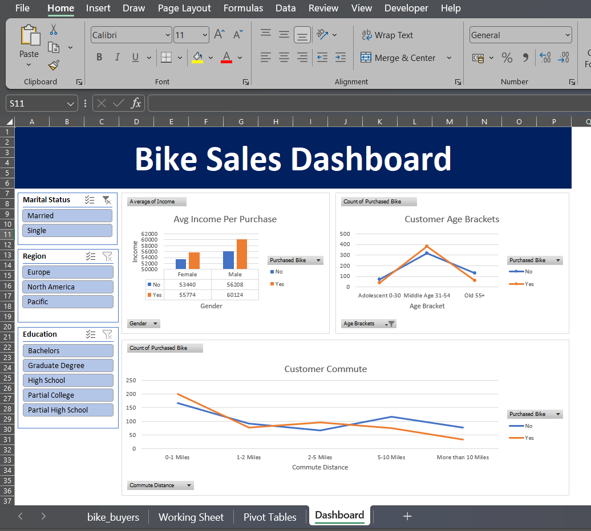

# 🚴 Bike Sales Customer Analysis & Dashboard — Microsoft Excel

## 📌 Project Overview
An end-to-end **Customer Data Analysis** project built in **Microsoft Excel**, analyzing
1,000 customer records to uncover key patterns in bike purchasing behavior across 
demographics, income levels, regions, and commute distances.

---

## 📸 Dashboard Preview


---

## 📁 Dataset Details
| Field            | Details                              |
|------------------|--------------------------------------|
| Total Records    | 1,000 rows                           |
| Total Columns    | 14 columns (after feature engineering)|
| Target Variable  | Purchased Bike (Yes / No)            |
| Bike Buyers      | 481 customers (48.1%)                |
| Non-Buyers       | 519 customers (51.9%)                |
| Avg Income       | $56,360                              |
| Regions Covered  | Europe, Pacific, North America       |

---

## 📊 Columns / Features
| Column            | Description                                      |
|-------------------|--------------------------------------------------|
| ID                | Unique customer identifier                       |
| Marital Status    | Married / Single                                 |
| Gender            | Male / Female                                    |
| Income            | Annual income in USD                             |
| Children          | Number of children                               |
| Education         | High School / Bachelors / Graduate Degree etc.   |
| Occupation        | Professional / Clerical / Manual etc.            |
| Home Owner        | Yes / No                                         |
| Cars              | Number of cars owned                             |
| Commute Distance  | 0-1 / 1-2 / 2-5 / 5-10 / 10+ Miles             |
| Region            | Europe / Pacific / North America                 |
| Age               | Customer age                                     |
| Age Brackets      | Adolescent (0-30) / Middle Age (31-54) / Old 55+ |
| Purchased Bike    | Yes / No (Target Variable)                       |

---

## 🔧 Steps Performed

### 1. Data Cleaning
- Standardized categorical values: M → Male / Female, M/S → Married / Single
- Removed duplicates and handled inconsistencies in raw data

### 2. Feature Engineering
- Created **Age Brackets** column from raw Age:
  - Adolescent: 0–30
  - Middle Age: 31–54
  - Old: 55+

### 3. Pivot Table Analysis
- Average Income by Gender & Bike Purchase
- Bike Purchase Count by Commute Distance
- Bike Purchase Rate by Age Bracket
- Regional breakdown of purchases
- Occupation-wise purchase patterns

### 4. Dashboard Design
- Interactive KPI Dashboard with:
  - Charts for all key dimensions
  - Slicers for Marital Status, Region & Education
  - Dynamic filtering for instant insights

---

## 💡 Key Insights
- 🏆 **Middle Age (31–54)** is the top buyer group — **383 out of 481** total buyers
- 💰 Bike buyers earn **~5.6% more** on average ($57,963) vs non-buyers ($54,875)
- 🌏 **Pacific region** showed the highest bike purchase conversion rate
- 🚗 Customers with **shorter commutes (0–1 mile)** are more likely to buy bikes
- 👔 **Professional & Management** occupations showed stronger purchase tendencies

---

## 📂 File Structure
```
Bike-Sales-Customer-Analysis-Excel/
│
├── Excel Project Dataset.xlsx   # Main Excel file with all 4 sheets
│   ├── bike_buyers              # Raw dataset (1,026 rows)
│   ├── Working Sheet            # Cleaned data + Age Brackets column
│   ├── Pivot Tables             # All pivot table analysis
│   └── Dashboard                # Interactive KPI Dashboard
│
├── Dashboard.png                # Dashboard screenshot
└── README.md                    # Project documentation
```

---

## 🛠️ Tools & Skills Used
- **Microsoft Excel** — Primary tool
- **Data Cleaning** — Standardizing labels, removing inconsistencies
- **Feature Engineering** — Creating Age Brackets from raw Age data
- **Pivot Tables** — Multi-dimensional analysis
- **Dashboard Design** — Charts, KPIs, and interactive slicers
- **Customer Segmentation** — Demographic & behavioral analysis

---

## 🚀 How to Use
1. Download `Excel Project Dataset.xlsx`
2. Open in **Microsoft Excel 2016 or later**
3. Go to the **Dashboard** sheet to explore visual insights
4. Use **slicers** to filter by Marital Status, Region & Education
5. Check **Pivot Tables** sheet for detailed breakdowns

---

## 👤 Author
**Chanchalla Manju**
📧 manjuchanchalla@gmail.com
🔗 www.linkedin.com/in/chanchalla-manju-0688062a3


---

## 🏷️ Tags
`Excel` `Data Analysis` `Customer Segmentation` `Dashboard` 
`Pivot Tables` `Data Cleaning` `Feature Engineering` 
`Business Intelligence` `Portfolio Project` `Bike Sales`
